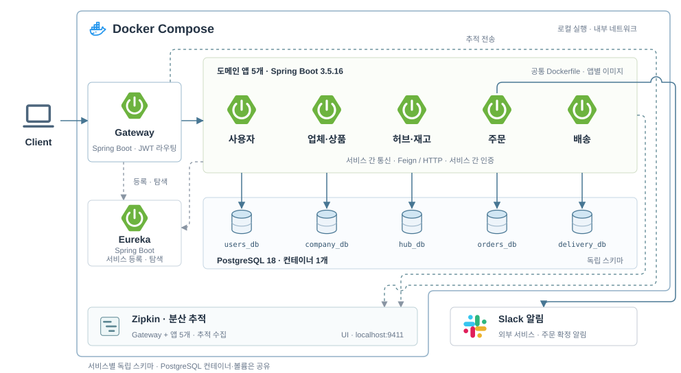
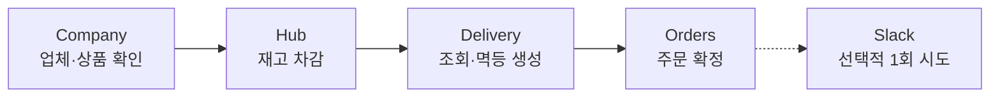

# 404 Not Found · Logistics MSA

업체의 상품을 주문하고, 허브 재고를 차감해 배송하는 물류 MSA 팀 프로젝트입니다.

> 로컬 개발 전용입니다. 배송 조회의 소유권 검사는 미구현이며, 재고 차감 결과 불명·배송 생성 실패의 자동 보상은 지원하지 않습니다.

[구성](#구성) · [주문 흐름](#주문-흐름) · [빠른 시작](#빠른-시작) · [문서 지도](#문서-지도)

## 구성



Gateway가 외부 요청을 받고, 서비스는 Eureka·Feign으로 통신합니다. PostgreSQL 컨테이너는 공유하고 DB·스키마·계정은 서비스별로 분리합니다.
서비스별 책임과 코드 의존 방향은 [서비스 구조](docs/architecture.md), 인증 책임과 구현 범위는 [인증·권한](docs/authentication.md)에서 확인합니다.

Java 21 · Spring Boot 3.5.16 · Spring Cloud 2025.0.3 · PostgreSQL 18.
버전 기준: [Gradle](build.gradle) · [Compose](compose.yml).

## 주문 흐름



정상 생성의 핵심 단계입니다. 취소·상태 전이·실패와 복구 경계는 [주문·배송 흐름](orders/README.md)을 따릅니다.

## 빠른 시작

Docker·Compose v2, Bash·OpenSSL·Python 3가 필요합니다.

```bash
git clone https://github.com/404notfound-team/logistics-msa.git
cd logistics-msa
bash scripts/init-env.sh
docker compose up -d --build --wait --wait-timeout 300
python3 scripts/smoke.py
python3 scripts/check-dev-data.py
```

[Swagger UI](http://localhost:8080/swagger-ui.html)에서 개발 계정으로 로그인합니다. [계정·샘플 조회](infra/dev-data/README.md#조회) · [환경·검증 명령](docs/development.md)

## 문서 지도

| 필요한 작업·정보 | 본문 |
| --- | --- |
| 서비스 책임·패키지 의존 방향 | [서비스 구조](docs/architecture.md) |
| JWT·인증 흐름·API별 권한 구현 | [인증과 권한](docs/authentication.md) |
| 응답·감사·내부 API·DB 스키마 계약 | [공통 개발 계약](docs/common-contracts.md) |
| Aggregate·서비스별 ERD | [도메인과 데이터 모델](docs/data-model.md) |
| 주문·취소·복구·멱등·실패 경계 | [주문 서비스](orders/README.md) |
| 로컬 환경·빌드·검증·기존 볼륨 | [개발 절차](docs/development.md) |
| 개발 계정·샘플·예약 ID·재적재 | [개발 데이터](infra/dev-data/README.md) |
| 실제 주문·타임아웃·재시작 검증 | [서비스 연동 테스트](integration-tests/README.md) |
| 이슈·브랜치·커밋·PR·리뷰 | [협업 규칙](CONTRIBUTING.md) |
