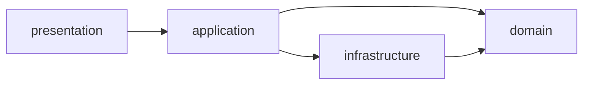

# 서비스 구성과 내부 구조

## 서비스 책임

| 모듈 | 소유 데이터·역할 | 공개 API 접두사 |
| --- | --- | --- |
| `users` | 계정·인증·역할·소속·배송 담당 여부 | `/api/users` |
| `company` | 업체·상품 | `/api/companies`, `/api/products` |
| `hub` | 고정 허브·기준 경로·재고 | `/api/hubs`, `/api/hub-routes`, `/api/stocks`, `/api/products/{productid}/stocks` |
| `orders` | 주문 스냅샷·생성·취소·복구 조정 | `/api/orders` |
| `delivery` | 배송·구간·담당자·상태 | `/api/deliveries` |
| `gateway` | 외부 진입점·인증·라우팅·Swagger UI | 위 경로만 명시적으로 라우팅 |
| `eureka` | 서비스 등록·탐색 | 내부 서비스 탐색 |

Eureka로 서비스를 찾고 Feign으로 호출합니다. 다른 서비스 DB의 직접 SQL·서비스 간 물리 FK·업무 엔티티 공유는 금지합니다.
`common:api`는 응답·오류, `common:audit`는 JPA 감사를 제공하는 라이브러리입니다. 별도 공통 서버는 없습니다.
Zipkin은 분산 추적, Slack은 Orders의 선택적 외부 Webhook 알림입니다. 기본 비활성이며 `.env`의 `SLACK_ENABLED`·`SLACK_WEBHOOK_URL`로 설정합니다.

## 서비스 내부 구조

루트 패키지는 `com.notfound.logistics.<service>`입니다. 그림은 코드 의존 방향이며 요청 처리 순서와 구분합니다.

| 계층 | 책임·경계 |
| --- | --- |
| `presentation` | Controller·HTTP DTO·입력 검증·오류 변환. 엔티티 응답 금지 |
| `application` | 유스케이스·권한 확인·트랜잭션·외부 호출 조율. 저장소·Feign 직접 주입 허용 |
| `domain` | 엔티티·불변식·업무 예외·저장소 인터페이스. HTTP·Feign·SecurityContext·다른 서비스 구현 참조 금지 |
| `infrastructure` | 저장소 구현·Feign/전송 DTO·인증·감사·설정. 경계에서 유스케이스 타입으로 변환 |

업무별 하위 패키지는 필요할 때만 만듭니다. 저장소의 Spring Data 상속은 허용하며 불필요한 인터페이스·기본 클래스를 추가하지 않습니다.

도구 버전은 [빌드 설정](../build.gradle)·[Compose](../compose.yml)를 따릅니다. Gradle 8.14.6, Zipkin 3.6.1을 사용합니다.
