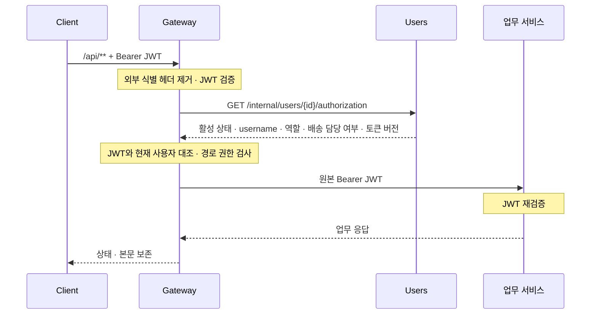

# 인증과 권한

## 현재 인증 흐름

`POST /api/users/signup`, `POST /api/users/signin`은 공개 API입니다. 로그인 JWT를 `Authorization: Bearer <JWT>`에 넣습니다.
두 공개 API는 `Authorization` 헤더를 읽지 않으므로 만료된 JWT가 붙어 있어도 로그인·가입할 수 있습니다.

`POST /api/users/signout`(204)은 본인의 `token_version`을 올려 그때까지 발급한 모든 JWT를 무효화합니다. 다른 기기의 로그인도 함께 끝나며, 다시 로그인하면 새 버전의 JWT를 받습니다.

## 업무 권한의 책임과 구현 현황

**설계상 책임:** 업무 데이터의 접근 권한은 해당 서비스가 판단합니다. 현재 인증 흐름은 위 다이어그램, API별 권한 구현 현황은 아래 표에서 확인합니다.

| 대상 | 현재 구현 범위 |
| --- | --- |
| Gateway | JWT·현재 사용자·경로별 역할 검사 적용. 업무 데이터의 소유권은 판단하지 않음 |
| 주문 조회·취소·삭제 | 조회·취소는 MASTER 또는 작성자, 삭제는 MASTER |
| 배송 상태 변경·담당자 배정 | 상태 변경은 MASTER 또는 해당 배송 담당자, 배정은 MASTER |
| 배송 목록·상세·경로 조회 | MASTER·일반 USER는 전체, 배송 담당자는 본인 배정 배송만 |

배송 조회 대상은 `GET /api/deliveries`, `GET /api/deliveries/{id}`, `GET /api/deliveries/{id}/routes`입니다.
배송 담당자는 목록의 전체 건수도 본인 배정 배송 기준이며, 다른 담당자 조건은 빈 목록입니다.
타인·미배정 배송의 상세·경로 조회는 403 `DELIVERY_READ_FORBIDDEN`, 없거나 삭제된 배송은 404입니다.
MASTER는 `is_delivery_staff=true`여도 전체 조회합니다. 배송 담당 여부가 없거나 boolean이 아닌 JWT는 401입니다.
근거: [배송 조회](../delivery/src/main/java/com/notfound/logistics/delivery/presentation/controller/DeliveryController.java), [배송 변경 권한](../delivery/src/main/java/com/notfound/logistics/delivery/application/service/DeliveryCommandService.java), [배송 JWT 인증](../delivery/src/main/java/com/notfound/logistics/delivery/infrastructure/security/DeliverySecurityConfiguration.java).

## JWT·서비스 인증 계약

| 계약 | 규칙 |
| --- | --- |
| JWT | HS256, `iss=logistics-users`, `sub=username`, UUID `user_id`, `role=MASTER/USER`, boolean `is_delivery_staff`, 정수 `token_version`, Unix 초 `iat`·`exp` |
| 신뢰 경계 | Gateway는 외부 `X-Service-Token`, `X-Actor-Username`, `X-User-*`를 대소문자 구분 없이 제거 |
| 내부 인증 | 발신자의 `<SERVICE>_SERVICE_TOKEN`을 `X-Service-Token`으로 전달. 수신자는 호출 서비스·허용 API 확인. 없거나 틀리면 401, 허용하지 않은 API는 403 |
| 감사 주체 | 검증된 username을 `X-Actor-Username`에 전달. 자동 복구는 저장된 요청자 사용 |
| actor 예외 | Gateway·Delivery→Users 계정 확인, 회원가입의 업체·허브 조회. 계정 확인에는 사용자 JWT를 보내지 않음 |
| Gateway 오류 | 인증 실패·사용자 상태 불일치 401, 역할 부족 403, Users 조회 실패·2초 초과 503 |

JWT는 암호화되지 않습니다. 비밀번호·토큰·Webhook URL을 저장소나 로그에 남기지 않습니다.
서비스 토큰은 서로 다른 값을 사용하고 상수 시간으로 비교합니다. `JWT_SECRET`은 32 UTF-8 바이트 이상, `ORDERS_SERVICE_TOKEN`은 16자 이상입니다.

## 권한과 사용자 생명주기

- 회원가입 시 MASTER/USER 선택을 허용합니다. 계정 생성 흐름을 단순하게 유지하기 위해 별도 관리자 가입 UI·승인 절차는 구현 범위에서 제외합니다([가입 정책 #18](https://github.com/404notfound-team/logistics-msa/issues/18)).
- 배송은 미배정 상태로 생성할 수 있습니다. 담당자를 배정할 때 Users의 활성 배송 담당 계정인지 확인하고, 배정된 담당자는 본인 계정으로 로그인해 배송 상태를 변경합니다. 존재하지 않거나 삭제된 계정은 404 `ASSIGNEE_NOT_FOUND`, 배송 담당자가 아닌 계정은 409 `ASSIGNEE_NOT_DELIVERY_STAFF`, 계정 확인 실패는 503 `USERS_UNAVAILABLE`이며 배송은 변경하지 않습니다.
- MASTER 전용: 사용자 목록·단건 조회/생성/수정/삭제, 재고 생성, 주문 삭제. `GET/DELETE /api/users/me`는 본인용입니다.
- USER는 업체·허브 중 정확히 하나에 소속됩니다. MASTER는 최대 하나이며 무소속도 허용합니다. 양쪽 동시 소속은 금지합니다.
- 삭제된 username도 재사용하지 않습니다. 삭제한 사용자는 조회·로그인에서 제외하며 마지막 MASTER 삭제는 막지 않습니다.
- 역할·배송 담당 여부 변경이나 로그아웃 시 Gateway가 기존 JWT를 거절합니다. 비밀번호 변경만으로 기존 JWT가 무효화되지는 않습니다.
- `token_version`은 Gateway만 대조합니다. Gateway를 거치지 않는 업무 서비스의 JWT 재검증은 버전을 보지 않습니다.
- 공개 사용자 경로·Swagger·Actuator·로컬 점검 경로는 Gateway의 Bearer 검사 대상이 아닙니다.

기준: [Gateway 인증](../gateway/src/main/java/com/notfound/logistics/gateway/auth/GatewaySecurityConfiguration.java), [Users 보안](../users/src/main/java/com/notfound/logistics/users/infrastructure/config/UserSecurityConfiguration.java).

내부 호출 경로·허용 발신자는 [내부 API 계약](common-contracts.md#서비스-간-내부-api-계약)을 따릅니다.
