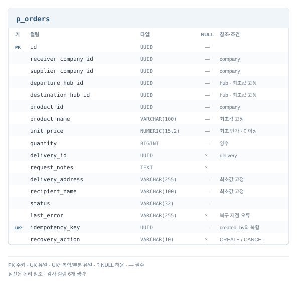

# 도메인과 데이터 모델

## Aggregate 경계

Aggregate는 함께 지킬 불변식과 변경 책임으로 나눕니다. User는 계정 생명주기, Stock은 허브·상품별 수량,
Delivery와 구간은 취소·삭제의 일관성을 보호합니다. 업체·상품 변경은 각 모델이 맡고 서비스 간에는 ID로 참조합니다.

## 서비스별 ERD

[사용자](#사용자) · [업체·상품](#업체상품) · [허브·재고](#허브재고) · [주문](#주문) · [배송](#배송)

서비스 간 ID는 논리 참조입니다. 그림의 NULL·키·관계 표기를 기준으로 읽으며 공통 감사 컬럼은 [감사 계약](common-contracts.md#api감사-계약)을 따릅니다.

### 사용자

### 업체·상품

### 허브·재고

### 주문

### 배송

