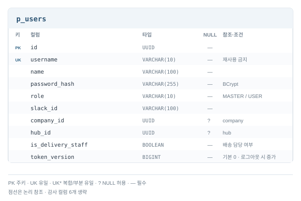
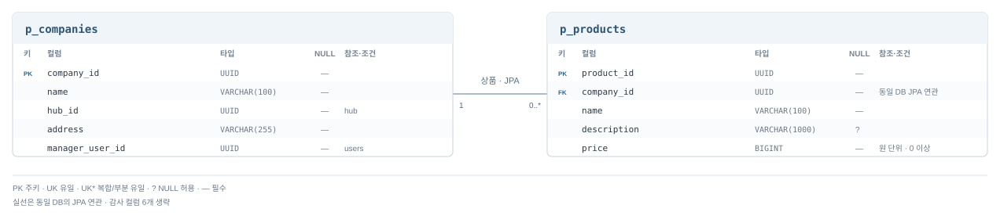
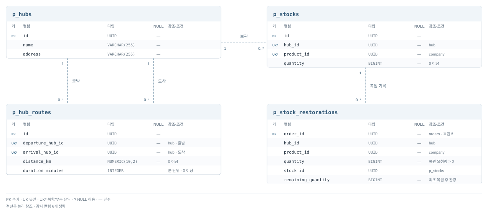
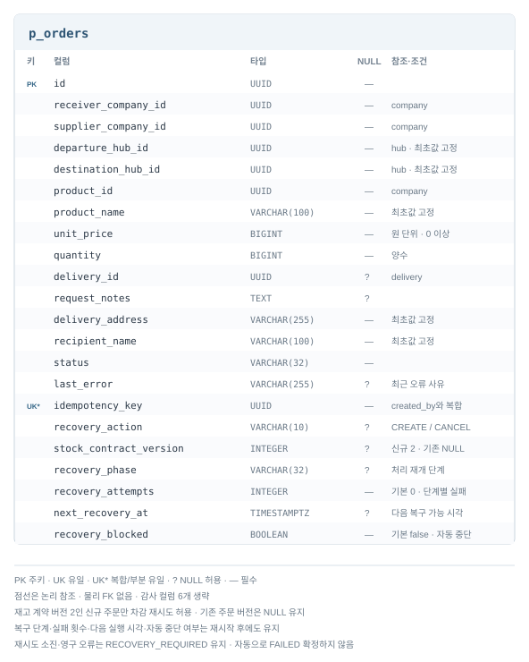
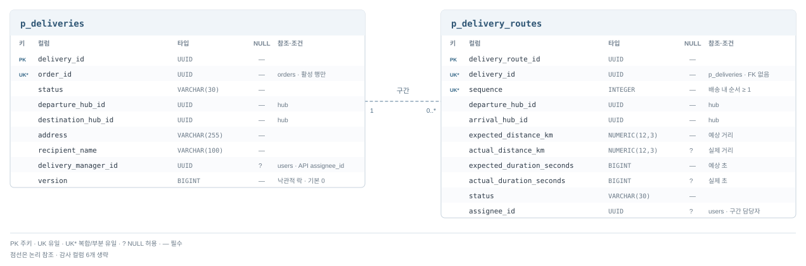

# 도메인과 데이터 모델

## Aggregate 경계

Aggregate는 함께 지킬 불변식과 변경 책임으로 나눕니다. User는 계정 생명주기, Stock은 허브·상품별 수량,
Delivery와 구간은 취소·삭제의 일관성을 보호합니다. 업체·상품 변경은 각 모델이 맡고 서비스 간에는 ID로 참조합니다.

차감·복원 기록은 재고 처리 결과를 보존하는 모델이며, 테이블 추가만으로 별도 Aggregate를 정의하지 않습니다.
재고 수량 변경과 해당 주문의 처리 기록은 Hub의 한 로컬 트랜잭션으로 저장하고, Orders가 서비스 간 처리·보상을 조율합니다.

## 서비스별 ERD

[사용자](#사용자) · [업체·상품](#업체상품) · [허브·재고](#허브재고) · [주문](#주문) · [배송](#배송)

서비스 간 ID는 논리 참조입니다. 그림의 NULL·키·관계 표기를 기준으로 읽으며 공통 감사 컬럼은 [감사 계약](common-contracts.md#api감사-계약)을 따릅니다.

### 사용자

### 업체·상품

### 허브·재고

| 테이블 | 책임·제약 |
| --- | --- |
| `p_stocks` | 허브·상품별 현재 수량. `(hub_id, product_id)` UNIQUE, 수량은 0 이상 |
| `p_stock_deductions` | `order_id` PK로 최초 차감 요청과 성공·확정 거절 보관. 요청 수량은 양수 |
| `p_stock_restorations` | `order_id` PK로 복원 완료와 최초 복원 직후 잔량 보관. 복원 수량은 양수 |

차감 성공은 `failure_code`가 null이고 `stock_id`·`remaining_quantity`가 존재하며 잔량은 0 이상입니다.
확정 거절은 `STOCK_NOT_FOUND` 또는 `INSUFFICIENT_STOCK`이고 재고 ID·잔량은 null입니다. 거절 기록은 재고와의 연결이 선택적입니다.
같은 주문·내용은 최초 결과를 재현하며, 복원 완료 주문은 다시 차감하지 않습니다.

최초 복원은 같은 주문의 차감 성공·재고 ID·허브·상품·수량을 검증합니다. 기존 복원 기록은 차감 기록 없이도 재현합니다.
차감·복원 기록은 주문 삭제와 함께 제거하거나 과거 처리 여부를 추정해 생성하지 않습니다.
요청·응답과 오류는 [내부 API 계약](common-contracts.md#서비스-간-내부-api-계약)을 따릅니다.

### 주문

주문은 최초 상품·단가·허브·배송 입력을 보존하고, 다음 컬럼으로 처리 재개 정보를 저장합니다.

| 컬럼 | 의미·기본값 |
| --- | --- |
| `recovery_phase` | 재개할 업무 단계. 최근 오류 사유인 `last_error`와 구분하며 종료 시 null |
| `recovery_attempts` | 단계별 실패 횟수. 기본 0이며 업무 단계 전환·종료 시 초기화 |
| `recovery_blocked` | 영구 오류·재시도 소진 시 자동 복구 중단. NOT NULL, 기본 false |

`recovery_phase`는 차감·배송 생성·배송 취소·재고 복원·생성 실패 보상의 재개 지점입니다.
주문 업무 상태는 `status`에 저장하고, 생성·취소 구분과 복구 작업자는 처리 단계에서 판단합니다. 최근 오류 사유로 재개 단계를 바꾸지 않습니다.
복구 정보는 재시작 후에도 유지합니다. 자동 복구가 중단되어도 결과 불명 주문은 `RECOVERY_REQUIRED`에 남기며 실패로 단정하지 않습니다.
생성 실패 보상은 복원 확인 후 FAILED, 사용자 취소는 복원 확인 후 CANCELLED로 종료합니다.
재시도와 개발 적용 순서는 [주문 복구](../orders/README.md#개발-적용)를 따릅니다.

### 배송

