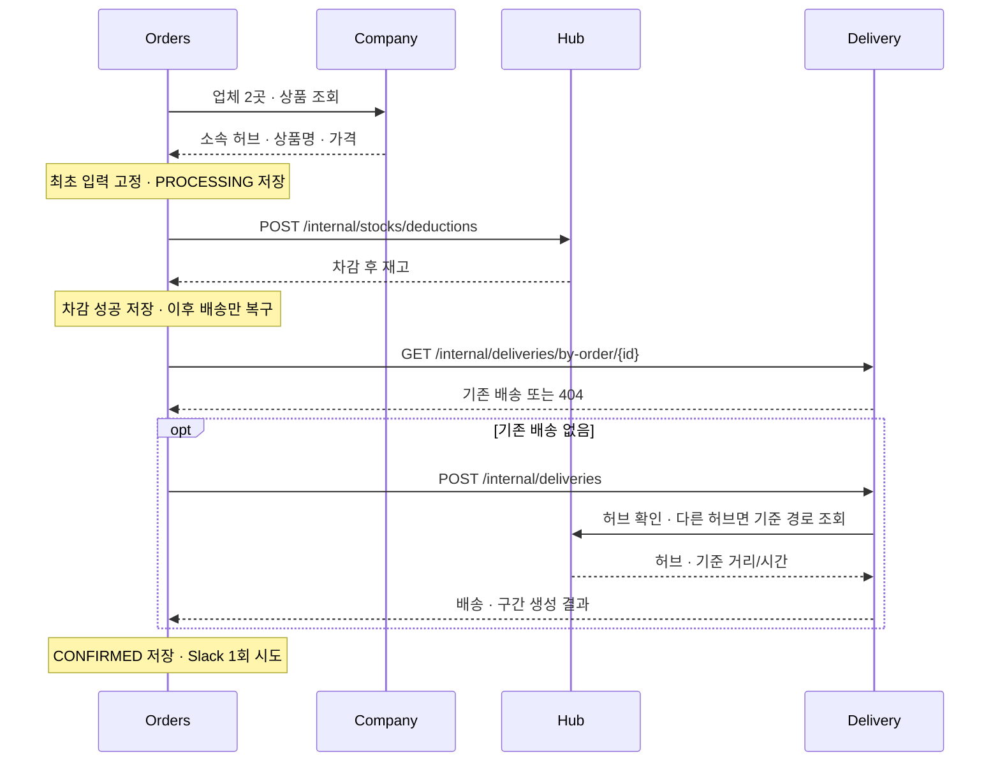
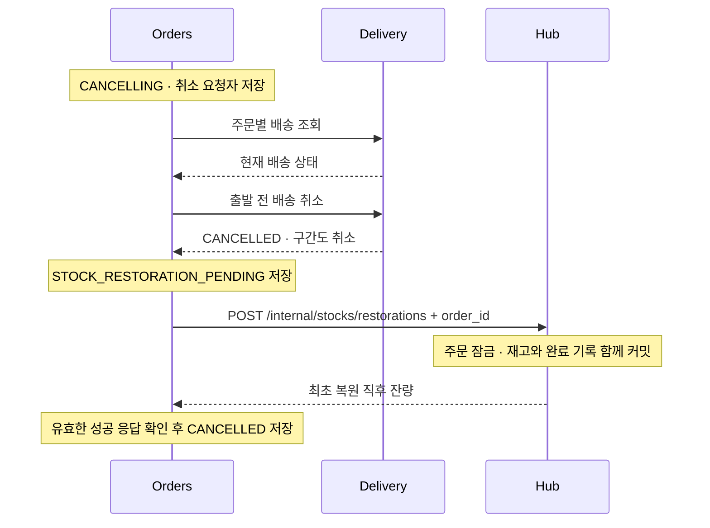
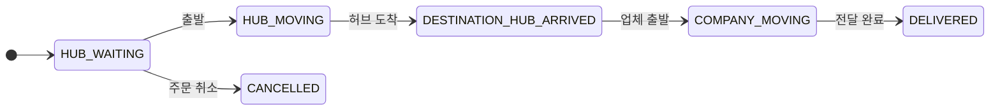

# 주문·배송 흐름과 복구

## 주문 생성

Orders는 외부 호출 중 DB 트랜잭션을 유지하지 않습니다. 단계별 의도·결과 불명 지점을 먼저 저장합니다.

| 공개 주문 API | 권한·결과 |
| --- | --- |
| `POST /api/orders` | 로그인 사용자, UUID `Idempotency-Key` 필수. 최초 확정 201 / 종료된 동일 요청 200 / 처리·복구 중 202 |
| `GET /api/orders`, `GET /api/orders/{id}` | MASTER 전체 / USER 본인. 최초 상품·가격·허브·배송 입력 반환 |
| `POST /api/orders/{id}/cancel` | MASTER·작성자. 완료 200 / 처리·복구 중 202 / 취소 불가 409 |
| `DELETE /api/orders/{id}` | MASTER. 배송 삭제 확인 후 논리 삭제 204 / 결과 불명 503, 동일 요청 재시도 |

멱등 키는 `(created_by, idempotency_key)`로 보호합니다. 같은 키·다른 입력이나 삭제된 주문의 키는 409입니다.
주소·수령인·요청사항의 앞뒤 공백을 제거하고 빈 요청사항은 null로 고정합니다.
단가는 Company와 같은 원 단위 정수(`Long`, DB `bigint`)입니다. 소수 금액·음수·Long 범위를 넘는 상품 응답은 거절합니다.
합계는 단가×수량을 `BigInteger`로 계산해 64비트 범위를 넘어도 정확한 정수로 반환합니다.
검색은 상품·상태·생성 기간(UTC, 양 끝 포함), 정렬은 `created_at`, `order_id`, `status`, `quantity`의 `asc/desc`를 지원합니다.

## 주문 취소와 재고 복원

위는 출발 전 정상 취소입니다. 이미 취소된 배송은 복원부터 이어갑니다. 배송 출발이 먼저 확정되면 409이며 재고를 복원하지 않습니다.

| 실패 지점 | 현재 처리·재시도 경계 |
| --- | --- |
| 차감 응답 유실·5xx·잘못된 응답·차감 단계 중단 | `FAILED`, 자동 재차감·복원 없음. **FAILED는 미차감을 뜻하지 않으며 새 키 재시도도 안전하지 않음** |
| 차감 후 배송 결과 불명 | `RECOVERY_REQUIRED`. 조회·같은 입력의 멱등 생성을 재개. 후속 404만으로 이전 호출 실패를 확정하지 않음 |
| 배송 생성 실패 확정 | 502·`FAILED`. 차감 재고 자동 보상은 미지원 |
| 배송 취소 결과 불명 | 배송 상태부터 재확인. 취소 확인 전 복원 금지 |
| 복원 실패·응답 유실·잘못된 응답 | 202·`RECOVERY_REQUIRED`. 저장한 복원 대기 지점부터 같은 주문 키로 복원 재개, 삭제 차단 |
| Hub 복원 후 Orders 최종 저장 실패 | 500·`CANCELLING`. 복원 대기 지점 유지, 같은 주문 키로 자동 복구·재시도하며 삭제 차단 |
| Slack 실패 | 주문 확정 유지. 같은 키 재요청으로 재전송하지 않으며 정확히 한 번 전달은 보장하지 않음 |

Slack 주문 확정 알림은 주문자 이름·계정명, 상품·수량·단가·합계, 배송 상태·담당자, 수령인·배송지·요청사항을 구분해 표시합니다.
주문·배송 UUID는 하단 조회용 번호로 남깁니다. 주문자는 감사 기록의 username, 담당자는 배송 생성·조회 응답의 실제 assignee_id로
Users 내부 API를 한 번 호출해 표시 이름을 가져옵니다. 미배정은 `미배정`, 배정됐으나 조회할 수 없는 이름은 `배정됨 · 이름 확인 불가`,
주문자 이름 조회 실패는 계정명으로 표시합니다. 이름 조회·Slack 전송 실패는 확정된 주문을 되돌리지 않으며 알림 비활성 시 이름 조회도 하지 않습니다.
요청사항은 1,000자까지 표시하고 사용자 입력은 Slack plain_text 블록에 넣어 멘션으로 해석되지 않게 합니다.

Hub는 주문별 advisory lock과 재고 행 잠금으로 복원합니다. 재고 증가와 `p_stock_restorations` 기록은 한 트랜잭션입니다.
같은 주문·허브·상품·수량은 최초 응답을 재현하고 다른 내용은 409 `STOCK_RESTORATION_CONFLICT`입니다.
기록에는 요청 수량·재고 ID·최초 복원 직후 잔량·감사 주체를 보존합니다. 후속 차감·재고 논리 삭제 후에도 같은 응답을 반환합니다.
복원 기록은 차감 성공 증명이 아닙니다. 조회·수정·삭제 API를 두지 않으며 주문 삭제와 함께 지우거나 과거 데이터를 추정해 채우지 않습니다.

## 상태 전이

복구 작업은 5초마다 최대 50건의 PROCESSING·CANCELLING·RECOVERY_REQUIRED를 확인하고 진행 중 작업은 건너뜁니다.
저장된 CREATE/CANCEL 의도로 재개하며 **Orders 단일 인스턴스**가 전제입니다. 차감 단계 중단은 재차감하지 않고 FAILED로 종료합니다.
삭제는 CANCELLED·FAILED 또는 배송 완료가 확인된 CONFIRMED에서 처리하고 진행 중·복구 중에는 거절합니다.

배송은 바로 다음 상태로만 진행하며 같은 상태 재요청은 변경하지 않습니다. 담당자 배정은 출발 전에만 가능합니다.
허브 이동을 시작하면 첫 미완료 구간이 `IN_TRANSIT`이 되고, 목적지 허브에 도착하면 남은 이동 구간이 모두 `ARRIVED`가 됩니다.
업체 이동·배송 완료에서도 구간은 `ARRIVED`를 유지합니다. 배송 상태와 구간 변경은 같은 트랜잭션으로 저장합니다.
배송·구간 취소/논리 삭제는 함께 처리하고 삭제는 DELIVERED·CANCELLED에서만 허용합니다.
실제 생성은 같은 허브면 구간 0개, 다른 허브면 기준 구간 1개입니다. 여러 구간을 가진 개발 샘플과 구분합니다.

기준: [주문 조정](src/main/java/com/notfound/logistics/orders/application/service/OrderService.java), [재고 변경](../hub/src/main/java/com/notfound/logistics/hub/application/service/stock/StockCommandService.java), [배송 생성](../delivery/src/main/java/com/notfound/logistics/delivery/application/service/DeliveryCreationService.java), [배송 상태](../delivery/src/main/java/com/notfound/logistics/delivery/domain/model/DeliveryStatus.java).

[내부 API 계약](../docs/common-contracts.md#서비스-간-내부-api-계약) · [실제 서비스 연동 검증](../integration-tests/README.md)
