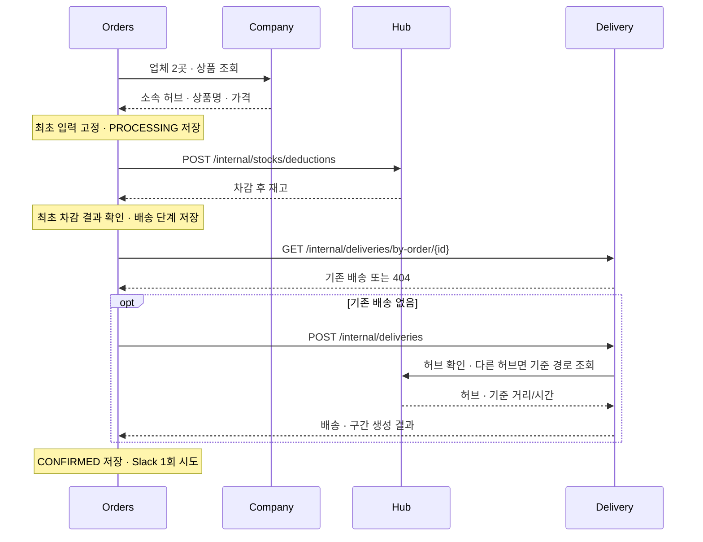
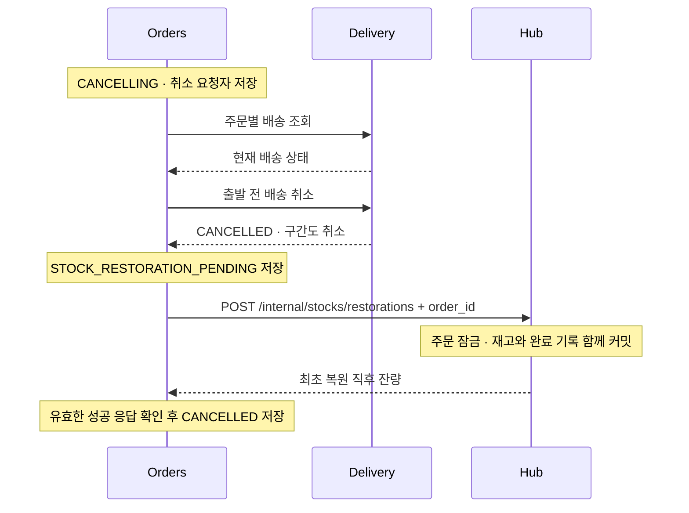
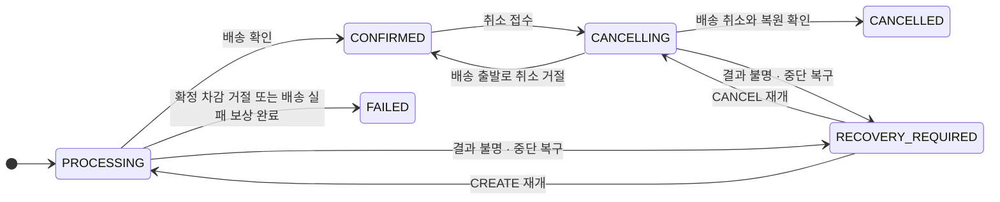
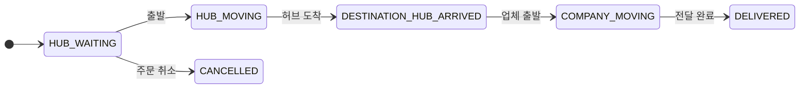

# 주문·배송 흐름과 복구

## 주문 생성



Orders는 외부 호출 중 DB 트랜잭션을 유지하지 않습니다. 단계별 의도·결과 불명 지점을 먼저 저장합니다.

| 공개 주문 API | 권한·결과 |
| --- | --- |
| `POST /api/orders` | 로그인 사용자, UUID `Idempotency-Key` 필수. 최초 확정 201 / 종료된 동일 요청 200 / 처리·복구 중 202 |
| `GET /api/orders`, `GET /api/orders/{id}` | MASTER 전체 / USER 본인. 최초 상품·가격·허브·배송 입력 반환 |
| `POST /api/orders/{id}/cancel` | MASTER·작성자. 완료 200 / 처리·복구 중 202 / 취소 불가 409 |
| `DELETE /api/orders/{id}` | MASTER. 배송 삭제 확인 후 논리 삭제 204 / 결과 불명 503, 동일 요청 재시도 |

멱등 키는 `(created_by, idempotency_key)`로 보호합니다. 같은 키·다른 입력이나 삭제된 주문의 키는 409입니다.
주소·수령인·요청사항의 앞뒤 공백을 제거하고 빈 요청사항은 null로 고정합니다.
단가는 Company와 같은 원 단위 정수(`Long`, DB `bigint`)입니다. 소수 금액·음수·Long 범위를 넘는 상품 응답은 거절합니다.
합계는 단가×수량을 `BigInteger`로 계산해 64비트 범위를 넘어도 정확한 정수로 반환합니다.
검색은 상품·상태·생성 기간(UTC, 양 끝 포함), 정렬은 `created_at`, `order_id`, `status`, `quantity`의 `asc/desc`를 지원합니다.

## 주문 취소와 재고 복원



위는 출발 전 정상 취소입니다. 이미 취소된 배송은 복원부터 이어갑니다. 배송 출발이 먼저 확정되면 409이며 재고를 복원하지 않습니다.

| 실패 지점 | 현재 처리·재시도 경계 |
| --- | --- |
| 차감 응답 유실·5xx·잘못된 응답·차감 단계 중단 | 새 계약 주문은 202·`RECOVERY_REQUIRED`. 같은 주문 ID·최초 입력으로 차감을 재요청해 Hub의 결과 재현 |
| 차감 후 배송 결과 불명 | `RECOVERY_REQUIRED`. 조회·같은 입력의 멱등 생성을 재개. 후속 404만으로 이전 호출 실패를 확정하지 않음 |
| 배송 생성 실패 확정 | 최초 시도의 확정 거절이면 재고 복원 완료 후 502·`FAILED`. 보상 결과 불명은 202·`RECOVERY_REQUIRED` |
| 배송 취소 결과 불명 | 배송 상태부터 재확인. 취소 확인 전 복원 금지 |
| 복원 실패·응답 유실·잘못된 응답 | 202·`RECOVERY_REQUIRED`. 저장한 복원 대기 지점부터 같은 주문 키로 복원 재개, 삭제 차단 |
| Hub 복원 후 Orders 최종 저장 실패 | 500·`CANCELLING`. 복원 대기 지점 유지, 같은 주문 키로 자동 복구·재시도하며 삭제 차단 |
| Slack 실패 | 주문 확정 유지. 같은 키 재요청으로 재전송하지 않으며 정확히 한 번 전달은 보장하지 않음 |
| 요청 충돌·서비스 인증 거절 등 영구 오류 | `RECOVERY_REQUIRED`·자동 복구 차단. 수량을 추정하거나 새 주문으로 대체하지 않음 |
| 재시도 예산 소진 | 결과 불명·처리 의도를 보존하고 자동 복구 차단. FAILED로 확정하지 않음 |

Slack 주문 확정 알림은 주문자 이름·계정명, 상품·수량·단가·합계, 배송 상태·담당자, 수령인·배송지·요청사항을 구분해 표시합니다.
주문·배송 UUID는 하단 조회용 번호로 남깁니다. 주문자는 감사 기록의 username, 담당자는 배송 생성·조회 응답의 실제 assignee_id로
Users 내부 API를 한 번 호출해 표시 이름을 가져옵니다. 미배정은 `미배정`, 배정됐으나 조회할 수 없는 이름은 `배정됨 · 이름 확인 불가`,
주문자 이름 조회 실패는 계정명으로 표시합니다. 이름 조회·Slack 전송 실패는 확정된 주문을 되돌리지 않으며 알림 비활성 시 이름 조회도 하지 않습니다.
요청사항은 1,000자까지 표시하고 사용자 입력은 Slack plain_text 블록에 넣어 멘션으로 해석되지 않게 합니다.

Hub는 주문별 advisory lock과 재고 행 잠금으로 복원합니다. 재고 증가와 `p_stock_restorations` 기록은 한 트랜잭션입니다.
같은 주문·허브·상품·수량은 최초 응답을 재현하고 다른 내용은 409 `STOCK_RESTORATION_CONFLICT`입니다.
기록에는 요청 수량·재고 ID·최초 복원 직후 잔량·감사 주체를 보존합니다. 후속 차감·재고 논리 삭제 후에도 같은 응답을 반환합니다.
최초 복원은 `p_stock_deductions`의 차감 성공·원래 대상·수량을 검증합니다. 기존 복원 영수증 재현은 먼저 수행합니다.
차감 영수증은 성공뿐 아니라 재고 부족·재고 없음 거절도 저장합니다. 거절 뒤 입고되어도 같은 주문은 거절됩니다.
기록의 조회·수정·삭제 API를 두지 않으며 주문 삭제와 함께 지우거나 과거 데이터를 추정해 채우지 않습니다.

## 상태 전이



복구 작업은 기본 실행 종료 후 5초 간격으로, 실행 시각이 된 최대 50건을 확인하고 진행 중·자동 차단 작업은 건너뜁니다.
저장된 CREATE/CANCEL 의도와 처리 단계로 재개하며 **Orders 단일 인스턴스**가 전제입니다.
`STOCK_DEDUCTION`·`DELIVERY_CREATION`·`DELIVERY_CANCELLATION`·`STOCK_RESTORATION`·`STOCK_COMPENSATION`을 저장하여 오류 원인과 재개 지점을 구분합니다.
생성 실패 보상은 복원 후 FAILED, 사용자 취소는 복원 후 CANCELLED로 종료합니다. 배송 결과가 불명인 요청의 후속 404만으로 보상하지 않습니다.
삭제는 CANCELLED·FAILED 또는 배송 완료가 확인된 CONFIRMED에서 처리하고 진행 중·복구 중에는 거절합니다.

## 재시도 설정과 저장 정보

| 항목 | 값·역할 |
| --- | --- |
| `orders.recovery.delay-ms` | 스케줄러 실행 종료 후 간격, 기본 5000ms |
| `orders.recovery.retry-delay-ms` | 첫 복구 대기, 기본 5000ms. 같은 단계 실패마다 증가하며 최대 300초 |
| `orders.recovery.max-attempts` | 단계별 실패 예산, 기본 20회. 최초 결과 불명도 한 회로 계산 |
| `recovery_phase` | 커밋된 재개 지점. 업무 단계가 진행되면 이전 재시도 예산 초기화 |
| `recovery_attempts`, `next_recovery_at` | 재시작 후에도 유지하는 실패 횟수·다음 실행 시각 |
| `recovery_blocked` | 영구 오류·예산 소진 시 true. 조회 대상에서 제외해 다른 주문을 막지 않음 |

Feign의 전역 자동 재시도는 끈 상태를 유지합니다. 재시도는 원래 작업자의 감사 컨텍스트에서 주문별 처리권을 확보한 작업만 수행합니다.
자동 차단은 운영 확인 대상이며 새로운 사용자 복구 API는 추가하지 않습니다. 원격 결과와 원인을 확인한 뒤 담당자가 재개 여부를 결정합니다.
재개 시 수량·주문 입력·차감 기록은 수정하지 않고 처리 의도와 원래 작업자를 보존합니다.

## 기존 주문과 적용 순서

신규 주문만 `stock_contract_version=2`로 생성합니다. 기존 행은 null이며 일괄 갱신하거나 FAILED 주문을 다시 열지 않습니다.
Hub의 멱등 구현을 먼저 배포하고 Orders를 적용합니다. 두 버전이 섞여 주문을 처리하지 않도록 전환 중 진행 작업을 확인합니다.
구버전 Hub를 사용하는 Orders에 새 재시도를 먼저 켜거나, 적용 후 Hub만 구버전으로 되돌리면 중복 차감될 수 있습니다.

| 기존 주문 | 처리 |
| --- | --- |
| 차감 단계 중단·결과 불명 | 자동 재차감 차단·확인 대상 보존 |
| CONFIRMED 주문의 신규 취소 | 배송을 건드리기 전에 409 `LEGACY_STOCK_CONTRACT`. 기존 차감 증거·호환 정책 확인 필요 |
| 기존 배송 결과 불명 | 기존 멱등 배송 조회·생성 복구 유지 |
| 이미 복원한 요청 | Hub의 기존 복원 영수증 재현 |
| 기존 취소 진행 중 차감 기록 없음 | 복원을 추정하지 않고 확인 대상으로 보존 |

개발 스키마는 local의 엔티티 갱신 후 기본 validate로 확인합니다. 새 주문 컬럼의 기본값은 횟수 0·자동 차단 false이며 계약 버전·단계는 과거 행에서 null을 허용합니다.
수량과 완료 기록은 보존하며 DB 초기화·추정 이력 채우기는 하지 않습니다.

## 차감 HTTP 장애 검증

JUnit의 기존 클라이언트 대체 구현은 주문 조율과 동시성 테스트에 사용합니다. 실제 Feign·직렬화·ErrorDecoder·타임아웃은 로컬 Postman 시뮬레이션으로 별도 검증합니다.
시뮬레이션은 현재 저장소의 Company·Hub·Delivery 계약을 바탕으로 만든 테스트 전용 구현입니다. 외부 소유자 mock 조회·클라우드 게시·실제 Slack 호출을 하지 않습니다.

```bash
postman simulation run orders/src/test/resources/postman/simulations/stock-recovery.sim.yaml --port 4905 --no-history
./gradlew :orders:test --tests '*OrderStockHttpRecoveryIntegrationTest' -PordersSimulationUrl=http://127.0.0.1:4905
```

Postman CLI 1.70 이상·Docker·Java 21이 필요합니다. 테스트 DB는 Testcontainers가 별도로 만듭니다.
시뮬레이션 URL을 주지 않으면 해당 HTTP 테스트만 건너뜁니다. Hub의 실제 수량·잠금·원자성은 Hub의 PostgreSQL 통합 테스트로 검증합니다.

실제 Hub JAR까지 연결하려면 같은 시뮬레이션을 실행한 상태에서 다음을 사용합니다. Company·Delivery만 대체하며 Hub·Orders는 실제 코드와 서로 분리된 Testcontainers DB를 사용합니다.

```bash
./gradlew :hub:bootJar :orders:test --tests '*OrderHubHttpIntegrationTest' -PordersSimulationUrl=http://127.0.0.1:4905 -PordersRealHubJar=hub/build/libs/app.jar
```

Windows PowerShell에서는 두 `-P...` 인자를 각각 따옴표로 감쌉니다. 테스트가 만든 Hub JVM과 DB만 종료하며 기존 Compose는 건드리지 않습니다.
차감 성공·거절·복원 INSERT를 실제 DB 잠금으로 지연해 Orders 타임아웃 뒤 Hub 커밋과 동일 요청 복구를 확인합니다.



배송은 바로 다음 상태로만 진행하며 같은 상태 재요청은 변경하지 않습니다. 담당자 배정은 출발 전에만 가능합니다.
허브 이동을 시작하면 첫 미완료 구간이 `IN_TRANSIT`이 되고, 목적지 허브에 도착하면 남은 이동 구간이 모두 `ARRIVED`가 됩니다.
업체 이동·배송 완료에서도 구간은 `ARRIVED`를 유지합니다. 배송 상태와 구간 변경은 같은 트랜잭션으로 저장합니다.
배송·구간 취소/논리 삭제는 함께 처리하고 삭제는 DELIVERED·CANCELLED에서만 허용합니다.
실제 생성은 같은 허브면 구간 0개, 다른 허브면 기준 구간 1개입니다. 여러 구간을 가진 개발 샘플과 구분합니다.

기준: [주문 조정](src/main/java/com/notfound/logistics/orders/application/service/OrderService.java), [재고 변경](../hub/src/main/java/com/notfound/logistics/hub/application/service/stock/StockCommandService.java), [배송 생성](../delivery/src/main/java/com/notfound/logistics/delivery/application/service/DeliveryCreationService.java), [배송 상태](../delivery/src/main/java/com/notfound/logistics/delivery/domain/model/DeliveryStatus.java).

[내부 API 계약](../docs/common-contracts.md#서비스-간-내부-api-계약) · [실제 서비스 연동 검증](../integration-tests/README.md)
